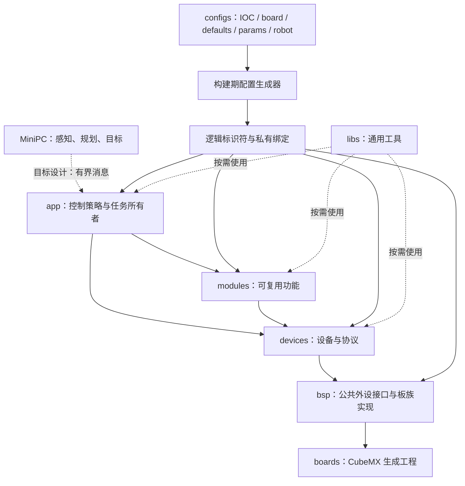

# PnX 架构与设计

PnX 是面向 STM32 与 ThreadX 的可复用下位机模板，具体机器人的控制策略由应用实现。本文根据用户提供的《PnX 架构与设计思想》及当前源码整理；需求与验收由 [SPEC.md](SPEC.md) 维护。下文“当前实现”表示源码核实结果，不代表已通过编译、硬件或实时性验证。

## 设计原则

1. **闭环留在 MCU。** 采样、估计、控制与执行器提交由 MCU 拥有；MiniPC 提供感知、规划或目标，其延迟与重连不应成为控制周期的等待条件。通用主机协议与完整控制应用尚未提供。
2. **硬件事实单一来源。** configs 内 IOC 拥有引脚、时钟、DMA、NVIC 和外设模式，CubeMX 代码为派生实现；同目录的板级 JSON 描述固定绑定与内存事实。业务使用生成的逻辑标识符，不重复硬件句柄与板号。
3. **共享语义，保留真实差异。** 构建时选择匹配板族的 BSP；公共接口应保持一致，CAN 能力、DMA 可达性与 cache 差异留在板级事实和私有实现，不支持的能力明确拒绝。当前仅能核实 H7 工作树，不能宣称 F4 实现已核验。
4. **资源与时间有所有者。** 明确对象、线程、回调目标、DMA/通信缓冲区的生命周期；周期任务定义触发源、优先级、最大等待、数据年龄和截止时间。初始化失败由资源创建者清理。
5. **接口表达物理意义。** 物理量注明 SI 单位、参考坐标系及必要换算，协议原始量标为 raw。本地接受、外设提交与执行器反馈分开观测。
6. **实现路径可追踪。** 从应用到模块、设备、BSP 能追踪数据、执行上下文和错误。新增封装须承担差异、所有权或复用职责，不为统一外观增设基类、服务定位器或注册中心。

## 分层与依赖

参考材料中的 pnx_bsp/pnx_devices/pnx_modules/pnx_libs 对应本仓库的实际目录如下，不据此重命名源码。参考材料的独立 diagnose/ 固件不在当前仓库范围；现有模块内诊断 API 不因此废弃。

| 位置 | 职责与新功能归属 |
| --- | --- |
| `boards/` | CubeMX HAL/RTOS、启动及其生成的原生构建产物；不是 PnX 配置来源 |
| `configs/` | IOC、固定资源、构建身份、工具链、产品链接脚本、preset、默认值、参数、设备组合及生成/编辑器入口 |
| `bsp/` | 板族外设操作、IRQ 桥、DMA/cache；公共 API 与私有绑定分离 |
| `devices/` | 设备协议、校准、单位转换、反馈与命令 |
| `modules/` | 组合设备与算法，拥有自己的服务线程和同步资源 |
| `libs/` | 不依赖特定机器人接线的消息、回调、状态、数学与控制工具 |
| `app/` | 任务编排、控制策略、工作模式、目标仲裁与产品失效处理 |

消费者可以直接使用下层公开能力，无需为经过每一层增设转发对象。BMI088 温控线程由设备内部拥有，生命周期与 SPI 访问协调仍由设备负责；不强制把所有线程集中到应用。

## 配置权威与构建

| 输入 | 权威范围 | 不应承担的职责 |
| --- | --- | --- |
| configs 内 IOC；CubeMX 产物为派生实现 | 引脚、时钟、DMA、NVIC、外设模式及初始化 | 应用目标与设备组合 |
| `board.json` | 已存在硬件资源的固定绑定、内存事实 | 通信策略与产品模式 |
| `params.json` | 策略参数与应用别名 | PCB 固定连线 |
| `robot.json` | 消费者启用与设备组合 | 重新定义 HAL 外设 |
| `defaults.json` | 生成器采用的默认值 | 隐藏覆盖用户明确配置 |

配置流程由 [generate_config.cmake](../../configs/cmake/generate_config.cmake) 与 [import_ioc.cmake](../../configs/cmake/import_ioc.cmake) 实现；具体字段与优先级以源码及实际 JSON 为准，不在文档复制参数表。

根 CMakePresets.json 只 include configs/CMakePresets.json，实际板型与构建选择在 configs 内。根构建、工具链、预览和编辑器均使用 configs/cmake/load_board.cmake，配置路径不依赖 boards。统一工具链 configs/cmake/gcc-arm-none-eabi.cmake 使用配置中的 CPU/FPU 与 memory.ld。根构建仅在消费生成源码时访问 boards/<板型>/cmake/stm32cubemx，并独立校验 BSP 板族。Configure 在构建目录生成 config.hpp、robot_config.hpp 和 bsp_bindings.cpp，并选择设备/模块源码，与 CubeMX 目标和 CMSIS-DSP 链接。pnx_embedded_sources.txt 是生成的选源清单，不是手工配置入口。

PNX_BOARD 不切换 BSP Git 分支。PNX_BSP_SOURCE_DIR 指定匹配工作树；PNX_PARAMS_OVERRIDE 与 PNX_ROBOT_CONFIG_OVERRIDE 属于开发验证入口。BSP 私有 src/ 包含目录仅对 BSP 源码和生成绑定开放。

## 启动与资源生命周期

**当前实现：** [app/app.cpp](../../app/app.cpp) 的 app_start() 为空。两板重生成源码中均有 main → MX_ThreadX_Init → tx_kernel_enter；ThreadX 经 tx_application_define() 调用 App_ThreadX_Init()。但两板的 App_ThreadX_Init() 均未调用 app_start()，所以 PnX 应用入口尚未接入。后续应在 USER CODE 区接入并核验资源初始化次序，不能把已有根构建注释当作已完成的调用链。

[AHRS](../../modules/ahrs/src/ahrs.cpp) 的 create_resources() 在同步资源、输出通道和温控启动之后创建采集线程，并有失败清理路径。该源码结构不等于创建失败、清理失败和重复初始化已在硬件通过验证。

**目标设计：** 应用在 app_start() 完成有界启动，持续工作交给明确拥有栈和控制块的线程。先准备依赖，再允许线程运行；失败仅清理本次创建的资源并报告真实错误。无需增加通用回滚框架。线程在使用期间依赖的对象、回调目标和缓冲区不能提前析构。

## 数据语义与跨上下文交接

| 语义 | 适用数据 | 契约与当前状态 |
| --- | --- | --- |
| latest 最新状态 | 姿态、目标、设备状态 | 新值可覆盖旧值；msg::channel 保存单份载荷，每个订阅者仅有待读标志，不保留历史 |
| 有界事件队列 | 模式切换、一次性命令、错误事件 | 需定义顺序、容量、满队列与重复语义；msg::channel 不提供这项保证 |
| 样本流 | 采样、记录、遥测 | 需定义时间戳、序号、丢样统计和背压；当前没有统一无损流契约 |

[msg.hpp](../../libs/msg/include/msg.hpp) 的 channel 对象显式拥有存储，同载荷类型的不同对象是独立通道；发布禁止 ISR，初始化/线程上下文另受接口约束。[msg.cpp](../../libs/msg/src/msg.cpp) 中默认阻塞发布和读取可能使用 TX_WAIT_FOREVER，available() 为非阻塞提示且锁竞争也返回 false。因此不能把现有通道描述为控制路径已保证有界，也不能用 available() 替代 read() 的实际结果。

推荐接收路径是有界捕获/通知 → 协议所有者组帧、校验与解码 → 一致状态 → 控制计算与提交。这是新链路设计原则，不声称现有所有驱动已转为线程解析。当前电机反馈仍由 CAN 接收路径更新。

上下文以具体 API 为准：[UART](../../bsp/usart/include/bsp_usart.hpp) 回调位于 HAL 中断/DMA 路径，不得阻塞；[USB](../../bsp/usb/include/bsp_usb.hpp) RX/TX 结果回调分别在读/写线程运行。USB RX 字节只在回调期间有效，异步转交前须复制；CDC 字节块不代表完整协议帧。通用回调是非拥有引用，目标生命周期由使用者保证。

**目标设计：** 跨上下文边界明确单写者、读取一致性与失效判定。按真实上下文选择临界区、互斥或拷贝交接；volatile 本身不保证一致快照。不为统一外观预置 SeqLock 或另一套消息框架。

## 控制、单位与反馈有效性

推荐应用链路：采样/反馈 → 状态估计 → 目标仲裁 → 控制计算 → 命令校验 → 执行器提交 → 状态观测。每一步明确单位、坐标系、有效期与所有者，坐标转换在显式边界完成。

**当前实现：** [IMU 状态](../../devices/imu/imu/include/imu.hpp) 带 sequence、received_tick、online，AHRS 发布时填入对应元数据。[电机 API](../../devices/motors/motor/include/motor.hpp) 的 get_feedback() 在临界区内按值复制反馈，并提供命令/模式检查；[motor_service](../../devices/motors/motor/include/motorservice.hpp) 负责启动、停止和控制报文提交。start() 可能等待 DM 使能超时总和，不能作为控制周期中的无等待操作。

一致快照不代表足够新，命令本地接受不代表已发送，send_control() 的提交结果不代表电机完成预期运动。USB try_send() 的 ok 同样只表示排队。反馈有效性须结合接收元数据、应用期限和设备状态判断。

**目标设计：** MCU 独立校验主机目标的年龄、序号与模式，并执行产品定义的失联输出、急停与安全包络。周期、最坏执行时间、锁持有时间、栈和 DMA 预算按板型测量；控制线程不等待 MiniPC、诊断输出或无界外设操作。阈值由实际机械结构和硬件保护决定，模板不提供未经验证的通用数值。

## 接口与配置体验

公开能力提供明确主入口，分步 init/start 必须解释状态转换。错误区分拒绝、忙、未配置和硬件失败。封装必须承担资源、上下文、差异或复用职责；协议解析和清理需要私有小函数时保留，不能机械以调用次数合并成巨型函数。修改公共接口前核对所有消费者及 H7/F4 支持义务。

接口说明先给最短合法调用路径，再写单位、支持范围、上下文、等待、生命周期与错误；示例只引用真实 API，不为当前空应用伪造完整用例。

[编辑器上下文导出](../../configs/cmake/export_editor_context.cmake) 提供板型/硬件文件契约；文件路径全部解析到 configs 内，已可脱离生成工程导出。目标工作流是选择意图 → 展示可选资源和默认来源 → 说明影响/冲突 → 原生成器最终校验 → 匹配构建与调试。编辑器不静默修改 IOC、固定绑定或其他板配置。错误应定位 JSON 路径、值、允许范围和修复位置；这是一项目标，未认定所有现有错误已达到该标准。Cortex Kit 等外部工具的安装与调试会话未在本次核验。

## 参考思想的采纳范围

用户提供材料对 RMCS、libxr、RPL 的归纳作为设计输入：采纳控制数据依赖与单位语义、初始化资源所有权、有界消息和校验先行。未独立核验仓库外原始资料，不引用缺失 PDF、外部源码或文档站链接作为本仓库实现证据。

不直接移植 ROS 装载/主机周期执行器、另一套 RTOS 适配层或运行时 topic 注册系统；RPL 的 C++20/内存池/版本协议不能直接当作当前 C++17、单核 MCU、ISR/cache 条件下的并发保证。

## 差距与实施顺序

以下是后续工作顺序，不是本次实现授权。具体验收约束见 SPEC。

| 顺序 | 工作与完成条件 |
| --- | --- |
| 1. 剩余启动接入 | 配置、根构建及 H723 链接已接通；F4 BSP 和两板 app_start 钩子仍待独立完成，不能由链接结果推断启动已完成 |
| 2. 初始化失败验证 | 针对 AHRS/设备创建失败与重试检查资源状态、错误返回和安全输出，不将现有清理分支当作测试结论 |
| 3. 数据与时间边界 | 保留已有反馈元数据，按实际消费者定义年龄上限；检查阻塞路径；仅在确有需求时增加独立有界事件或样本流 |
| 4. 产品控制应用 | 定义任务、目标有效期、仲裁与失联输出，再测量截止时间、栈和 DMA 预算，不提前引入通用控制框架 |
| 5. 配置与调试体验 | 在可构建工程上验证板选择、配置检查、生成结果与匹配 ELF/芯片的工作流，再决定专用工具范围 |

配置集中化约束与剩余限制统一记录在 SPEC，配置文件职责和优先级见 [configs/README.md](../../configs/README.md)；不恢复旧工程、不创建新旧别名层。构建、故障注入、设备实测与控制截止时间分别提供证据，不能互相替代。
