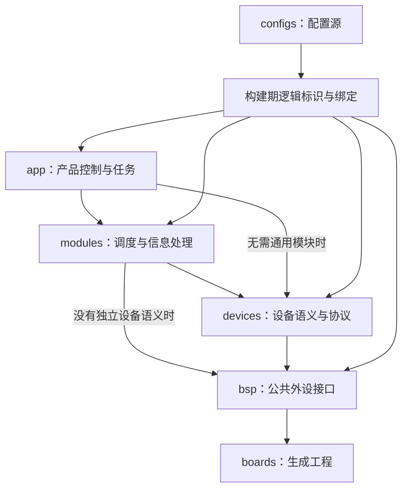

# PnX 架构与设计

PnX 是面向 STM32 与 ThreadX 的可复用机器人固件模板。本文说明职责、依赖、数据流和资源所有权；规则与验收见 [SPEC](SPEC.md)，配置使用见 [configs/README](../../configs/README.md)。实施与验证记录保留在现有任务计划，不作为通用设计的一部分。

## 职责与依赖

| 位置 | 职责 |
| --- | --- |
| `configs/` | IOC、构建身份、链接布局、固定绑定、参数和设备组合的唯一来源 |
| `boards/` | CubeMX 生成的启动、HAL、RTOS 与原生工程 |
| `bsp/<板型>/<外设>/`、`bsp/shared/` | 公共外设操作、IRQ 桥接、DMA/cache 和板族差异；USB、DWT 的相同实现由两板共享 |
| `devices/` | 设备协议、能力、校准、单位转换、命令和反馈 |
| `modules/` | 可复用的调度、解算、信息处理、事件及状态发布 |
| `libs/` | 不依赖硬件和业务的消息、回调、数学及控制工具 |
| `app/` | 产品任务装配、控制策略、目标仲裁和失效处理 |

层级表达职责和依赖方向。调用选择有实际意义的路径，不为经过每个目录增加转发对象。设备语义由设备接口解释，模块处理调度和发布；上层使用 BSP 公开接口时，仍由配置选择硬件，不把 HAL 句柄或板族判断带入业务。libs 可被各层使用。

同类设备共享上层所需的读数和能力，真实协议差异留在具体实现。同步访问和异步解码均属于设备层，不按传输方式划出重复设备族。发布状态复用设备族数据，增加来源、序号、时间或事件；消费状态不需要包含完整驱动依赖。通用目录只容纳不含板型、设备和业务知识的能力。

## 配置与装配

IOC 描述引脚、时钟、DMA、NVIC 和外设模式；board 描述固定资源与内存事实；params 描述策略参数和应用别名；robot 描述设备组合；defaults 提供默认值。字段和覆盖顺序只在 [配置指南](../../configs/README.md) 维护，不在设计文档复制参数表。

配置加载器供构建、独立预览和编辑器共用。生成器校验资源与选项，在构建目录生成逻辑标识、设备配置和绑定；`bsp_bindings.cpp` 连接私有硬件，具体设备由其消费者根据生成配置直接装配，例如 gamepad 实现内选择 PS2 GPIO/SPI 对象。生成文件和选源清单是派生产物，不能成为第二份配置源。

构建选择当前板型的 BSP 及其 target.cmake 明确声明的共享 BSP 根目录。USB 和 DWT 在 `bsp/shared/` 维护一份实现，使用当前生成配置及芯片头；CAN 能力、DMA 可达性和 cache 差异由板级实现承担。不支持的能力明确拒绝，修改公共契约时同时核对两板。

配置启用决定源码选择和绑定，运行启动由应用负责。板级 ThreadX 钩子进入 [app_start()](../../app/app.cpp)，当前入口仅初始化基础日志。产品在此装配所需模块和控制任务，明确启动次序及失败策略；模板不自动启动所有可编译模块。

## 生命周期与异步交接

对象、缓冲区、回调目标和 RTOS 资源有明确所有者。先准备数据处理所需资源，再允许回调到达或线程执行。初始化失败只撤销本次获得的资源；生产者停止失败时，仍可能被访问的对象与存储继续有效。重复初始化、运行期重启和失败后重建是不同状态转换。

回调借用目标，不延长对象生命周期；接收字节的有效期以驱动接口为准，跨回调使用前复制或显式转移所有权。UART 回调位于中断/DMA 路径，USB 回调可在线程执行，不能只凭回调名称判断上下文。字节块也不天然等于完整协议帧。

接收链路为捕获数据和时间 → 协议所有者组帧、校验、解码 → 一致状态 → 消费者。模块可直接拥有通信缓冲和回调，不为访问端口重复建设备对象或登记表。需要周期轮询的设备仍由模块调度，设备操作自身不创建线程。

## 调度与共享事务

任务根据触发源、频率、截止时间和失败策略划分，不强制一模块一线程。采样与温控需要独立频率，且校准等待期间温控继续运行，因此分别调度；访问同一设备不能成为合并独立职责的理由。

互斥保护一次不可交错的完整事务，包括资源选择、通信和释放。协议要求保持选择状态的时序属于事务，算法、PID、姿态解算及休眠不属于事务。等待上界和传输超时共同决定最坏占用；有限等待并不等于无抖动。

对象锁保护该对象的访问。多个对象共享总线时，由总线所有者协调事务，不能依靠不同对象各自的锁保证总线互斥。周期变化还需核对时基、通信超时、执行预算和硬件保护期限。

## 数据与时间

数学值类型与单位转换统一归 `libs/math`：三维向量和四元数使用固定尺寸内联运算，欧拉角输出为弧度；固定矩阵的乘法与转置调用独立编译的 CMSIS-DSP。两个 AHRS EKF 共享这些实现，求解器保留自己的噪声、条件判定与恢复策略。3×3 求逆保留直接余子式计算，由调用方指定行列式拒绝阈值；不为复用库改变既有数值判定。

| 数据语义 | 用途 | 特性 |
| --- | --- | --- |
| latest | 姿态、目标、设备状态 | 保存最新载荷，旧值可被覆盖，不保留历史 |
| 有界事件队列 | 一次性命令、模式切换、错误事件 | 需要独立定义顺序、容量和满队列策略 |
| 样本流 | 采样、记录、遥测 | 需要独立定义时间戳、序号、丢样及背压 |

当前 [msg](../../libs/msg/include/msg.hpp) 提供 latest 通道。通道拥有存储，同类型的不同对象相互独立；默认读写不等待锁，竞争返回 busy。available() 只是提示，read() 的结果才决定是否得到数据。调用方决定保留旧值或跳过；latest 不承担无损事件和样本流的职责。

生产者拥有工作状态，完成更新后发布一致快照。数据年龄来源于接收或采样时间，排队、解码和重复发布不使数据变新。分帧结果以组成部分的年龄判断有效性；曾收到数据、当前在线和足够新分别表达。调试引用只用于观察，不能代替控制输入快照。

一个控制周期由周期所有者捕获所需输入，再传给各控制器，避免各自读取 latest 得到不同版本。单通道快照不自动保证跨通道同周期一致。现有 latest 通道也不提供这种整周期装配能力，具体应用需要明确其输入边界。

## 控制与执行器

控制链路为采样/反馈 → 状态估计 → 目标仲裁 → 控制计算 → 命令校验 → 执行器提交。每个边界明确单位、坐标系、有效期和状态。主机提供目标，MCU 拥有闭环和产品失效策略，主机延迟不成为周期等待条件。

物理接口与协议 raw 接口分开，换算具有型号、轴端和标定来源。缺少换算参数时明确未配置，不用推测常数填补。设备命令 setter 承担单位、模式与校验；协议 handler 承担组帧、接收分发及协议启停，调用顺序由实际消费者决定，不增加通用 motor_service。

| 阶段 | 表达的结果 |
| --- | --- |
| 保存命令 | 目标经过本地校验，尚未保证发送 |
| 外设提交 | 本地驱动接受或拒绝，不代表报文已离开外设 |
| 发送完成 | 外设完成传输，不代表设备已执行 |
| 设备反馈 | 根据协议与时间判定设备状态，不自动证明运动符合预期 |

多个 handler 依次提交不具有跨总线原子性或同步生效保证。多帧发送可能部分成功，软件不能撤回已经提交的报文。协议组帧、同周期输入一致和硬件同步输出分别设计与验收。

## 故障、日志与调参

错误状态区分拒绝、忙、未配置、未初始化、超时和操作失败。查询直接返回值，不会失败的赋值或重置无需伪造成功返回。停用、降级和恢复由能力及产品策略决定，重试有明确边界和可恢复状态。

保护动作的请求与执行结果分别观察。软件不能因存在硬件保护就忽略操作失败；硬件保护也不能由线程正常运行推导成立。板上周期、最坏耗时、锁占用、栈及 DMA 预算按实际配置测量。

[基础日志](../../libs/log/include/log.hpp) 是固定容量、非阻塞的故障线索，不替代返回状态或控制输入。保留 RAM 支持部分复位后的观察，不承担断电持久化；具体参数和调试入口见配置指南与 README。

在线参数使用明确实体，批量更新需暂停相关执行或提供一致更新机制。计时直接使用平台单调时间接口，统计工具处理调用方传入的耗时和预算，不再注册另一套时钟或自动计时层。

## 配置工具边界

配置工具展示来源、可选资源和冲突，最终调用现有生成器校验，不维护另一套硬件事实或静默修改接线。构建板型、调试芯片与 ELF 必须匹配。当前编辑器上下文导出只提供文件和资源契约，外部工具会话及完整产品工作流需分别验证。

具体机器人控制应用、事件/样本流及产品安全策略尚需产品设计与验收；当前模板不提供这些完整能力。
