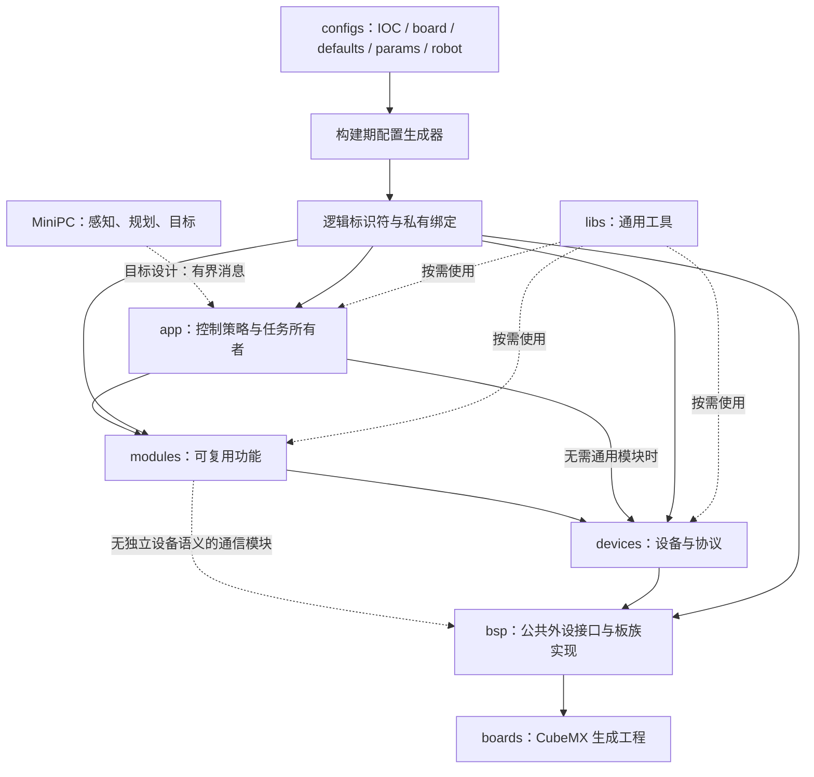

# PnX 架构与设计

PnX 是面向 STM32 与 ThreadX 的可复用下位机模板，具体机器人的控制策略由应用实现。本文根据用户提供的《PnX 架构与设计思想》及当前源码整理；需求与验收由 [SPEC.md](SPEC.md) 维护。本文维护项目通用设计与必要的架构说明；规则、限制和验收要求归 SPEC，参数归 configs，具体实现进度、已知缺口和验证结果归现有任务计划，不逐轮追加实现流水账。

## 设计原则

1. **闭环留在 MCU。** 采样、估计、控制与执行器提交由 MCU 拥有；MiniPC 提供感知、规划或目标，其延迟与重连不应成为控制周期的等待条件。通用主机协议与完整控制应用尚未提供。
2. **硬件事实单一来源。** configs 内 IOC 拥有引脚、时钟、DMA、NVIC 和外设模式，CubeMX 代码为派生实现；同目录的板级 JSON 描述固定绑定与内存事实。业务使用生成的逻辑标识符，不重复硬件句柄与板号。
3. **共享语义，保留真实差异。** 构建时选择匹配板族的 BSP；公共接口应保持一致，CAN 能力、DMA 可达性与 cache 差异留在板级事实和私有实现，不支持的能力明确拒绝。仓库内提供 H723/F407 实现，编译和主机测试不等于板上验证。
4. **资源与时间有所有者。** 明确对象、线程、回调目标、DMA/通信缓冲区的生命周期；周期任务定义触发源、优先级、最大等待、数据年龄和截止时间。初始化失败由资源创建者清理。
5. **接口表达物理意义。** 物理量注明 SI 单位、参考坐标系及必要换算，协议原始量标为 raw。本地接受、外设提交与执行器反馈分开观测。
6. **实现路径可追踪。** 从应用到模块、设备、BSP 能追踪数据、执行上下文和错误。新增封装须承担差异、所有权或复用职责，不为统一外观增设基类、服务定位器或注册中心。

## 分层与依赖

参考材料中的 pnx_bsp/pnx_devices/pnx_modules/pnx_libs 对应本仓库的实际目录如下，不据此重命名源码。参考材料的独立 diagnose/ 固件不在当前仓库范围；现有模块内诊断 API 不因此废弃。

| 位置 | 职责与新功能归属 |
| --- | --- |
| `boards/` | CubeMX HAL/RTOS、启动及其生成的原生构建产物；不是 PnX 配置来源 |
| `configs/` | IOC、固定资源、构建身份、工具链、产品链接脚本、preset、默认值、参数、设备组合及生成/编辑器入口 |
| `bsp/<板型>/<外设>/` | 两板外设操作、IRQ 桥、DMA/cache；include 是公共 API，src 是私有实现 |
| `devices/` | 设备协议、校准、单位转换、反馈与命令 |
| `modules/` | 有实际复用价值的解算、信息处理与执行单元；可由周期所有者调用，也可按需求拥有线程，不强制一模块一线程 |
| `libs/` | 不依赖特定机器人接线的消息、回调、状态、数学与控制工具 |
| `app/` | 任务编排、控制策略、工作模式、目标仲裁与产品失效处理 |

层级规定职责和依赖方向，不规定每条调用必须经过全部目录。推荐链路为 app/controllers → modules → devices → bsp → boards；只在中间层有实际语义时经过它。app 可以直接调用设备的物理量接口；纯通信模块没有独立设备概念时，可以依赖 BSP 的公开通信接口。不得绕过已经承担协议、校准或安全校验的设备接口，直接拼报文操作同一个设备。上层仍不得访问 HAL 句柄、寄存器、BSP 私有绑定或板族条件分支，物理端口由 configs 装配。

libs 可被任意层使用，自身不依赖 BSP、设备或业务模块。设备封装操作、协议、资源和反馈，不创建线程；同步锁和回调不等于线程所有权。模块只有承担复用算法、状态管理、数据发布或执行策略时才成立。禁止反向业务依赖和循环依赖；配置装配知道上下层类型，运行时回调依赖抽象签名。此规则替代此前“绝对逐层调用”的约束，避免为满足目录层级制造转发对象。

## 配置权威与构建

| 输入 | 权威范围 | 不应承担的职责 |
| --- | --- | --- |
| configs 内 IOC；CubeMX 产物为派生实现 | 引脚、时钟、DMA、NVIC、外设模式及初始化 | 应用目标与设备组合 |
| `board.json` | 已存在硬件资源的固定绑定、内存事实 | 通信策略与产品模式 |
| `params.json` | 策略参数与应用别名 | PCB 固定连线 |
| `robot.json` | 消费者启用与设备组合 | 重新定义 HAL 外设 |
| `defaults.json` | 生成器采用的默认值 | 隐藏覆盖用户明确配置 |

配置流程由 [generate_config.cmake](../../configs/cmake/generate_config.cmake) 与 [import_ioc.cmake](../../configs/cmake/import_ioc.cmake) 实现；具体字段与优先级以源码及实际 JSON 为准，不在文档复制参数表。

根 CMakePresets.json 只 include configs/CMakePresets.json，实际板型与构建选择在 configs 内。根构建、工具链、预览和编辑器均使用 configs/cmake/load_board.cmake，配置路径不依赖 boards。统一工具链 configs/cmake/gcc-arm-none-eabi.cmake 使用配置中的 CPU/FPU 与 memory.ld。根构建仅在消费生成源码时访问 boards/<板型>/cmake/stm32cubemx，并独立校验 BSP 板族。Configure 在构建目录生成 config.hpp、robot_config.hpp 和 bsp_bindings.cpp，并选择设备/模块源码，与 CubeMX 目标和 CMSIS-DSP 链接。pnx_embedded_sources.txt 是生成的选源清单，不是手工配置入口。

PNX_BOARD 自动选择同名 BSP 目录，不切换 Git 分支。PNX_BSP_SOURCE_DIR 默认留空，显式覆盖时指向包含 target.cmake 的板型目录；PNX_PARAMS_OVERRIDE 与 PNX_ROBOT_CONFIG_OVERRIDE 属于开发验证入口。BSP 私有 src/ 包含目录仅对 BSP 源码和生成绑定开放。

### 双板实现边界

bsp/h723_dmmc02 与 bsp/f407_cboard 下按 can、spi、usart、gpio、pwm、exti、dwt、usb 和 bsp（DMA buffer）细分；H723 另有 adc。target.cmake 仅声明实现适用的家族；产品选择和配置仍位于 configs。构建只包含当前板的源码和头。

F407 bxCAN 采用历史 c147b1d 的 CAN1/CAN2 过滤器分区和 HAL 操作，适配当前生成 binding、core::callback、restart 与错误信号量。标准/扩展标识符按配置过滤，拒绝远程帧、超长载荷及越界 ID；一次 IRQ 最多处理三个 FIFO 槽位。bus-off 时尝试一次恢复并保存结果，消费者可通过 current_status() 观察并再次 init()；ISR 不等待或循环重试。当前 IOC 未开启 SCE IRQ，错误中断完整路径需硬件核验。

其他外设沿用当前资源和接口模型，F407 SPI 移除无 D-cache 芯片不需要的维护路径。公共头保持一致；逻辑相同的实现按用户要求保留在各板型目录，修改共享契约时同时核对两板。旧 flash/indicator/diagnostics 无当前有效消费者，不恢复旧框架；GPIO 指示灯使用生成固定绑定。F407 ADC 不在当前支持范围，启用时根构建拒绝。

## 启动与资源生命周期

**当前实现：** 两板均通过 main → MX_ThreadX_Init → tx_kernel_enter → tx_application_define() → App_ThreadX_Init() 进入 [app_start()](../../app/app.cpp)。当前应用入口只初始化基础日志并记录启动事件，尚未创建机器人控制任务。

[AHRS](../../modules/ahrs/src/ahrs.cpp) 的 create_resources() 先准备设备事务锁、同步资源和输出通道，创建挂起的温控线程，再启动采样线程。采样线程完成传感器配置与身份检查后释放温控线程；达到温度条件后校准并进入 DRDY 采样，并有资源创建失败清理路径。该源码结构不等于创建失败、清理失败和重复初始化已在硬件通过验证。

**目标设计：** 应用在 app_start() 完成有界启动，持续工作交给明确拥有栈和控制块的线程。先准备依赖，再允许线程运行；失败仅清理本次创建的资源并报告真实错误。无需增加通用回滚框架。线程在使用期间依赖的对象、回调目标和缓冲区不能提前析构。

## 数据语义与跨上下文交接

| 语义 | 适用数据 | 契约与当前状态 |
| --- | --- | --- |
| latest 最新状态 | 姿态、目标、设备状态 | 新值可覆盖旧值；msg::channel 保存单份载荷，每个订阅者仅有待读标志，不保留历史 |
| 有界事件队列 | 模式切换、一次性命令、错误事件 | 需定义顺序、容量、满队列与重复语义；msg::channel 不提供这项保证 |
| 样本流 | 采样、记录、遥测 | 需定义时间戳、序号、丢样统计和背压；当前没有统一无损流契约 |

[msg.hpp](../../libs/msg/include/msg.hpp) 的 channel 对象显式拥有存储，同载荷类型的不同对象是独立通道；发布禁止 ISR，初始化/线程上下文另受接口约束。[msg.cpp](../../libs/msg/src/msg.cpp) 的默认发布、读取与订阅均不等待互斥锁。读写竞争返回 busy，不覆盖已有载荷、不消费待读标志；调用方决定保留上一帧或跳过本次发布。available() 只是非阻塞提示，不能替代 read() 的实际结果。显式 publish_opts.block=true 仍允许线程阻塞发布，不用于控制周期；非阻塞锁本身也不保证整个周期满足截止时间。

推荐接收路径是有界捕获/通知 → 协议所有者组帧、校验与解码 → 一致状态 → 控制计算与提交。这是新链路设计原则，不声称现有所有驱动已转为线程解析。当前电机反馈仍由 CAN 接收路径更新。

上下文以具体 API 为准：[UART](../../bsp/h723_dmmc02/usart/include/bsp_usart.hpp) 回调位于 HAL 中断/DMA 路径，不得阻塞；[USB](../../bsp/h723_dmmc02/usb/include/bsp_usb.hpp) RX/TX 结果回调分别在读/写线程运行。USB RX 字节只在回调期间有效，异步转交前须复制；CDC 字节块不代表完整协议帧。通用回调是非拥有引用，目标生命周期由使用者保证。绑定空对象返回无效 callback，调用前由消费者检查有效性。

**目标设计：** 跨上下文边界明确单写者、读取一致性与失效判定。按真实上下文选择临界区、互斥或拷贝交接；volatile 本身不保证一致快照。不为统一外观预置 SeqLock 或另一套消息框架。

## 控制、单位与反馈有效性

推荐应用链路：采样/反馈 → 状态估计 → 目标仲裁 → 控制计算 → 命令校验 → 执行器提交 → 状态观测。每一步明确单位、坐标系、有效期与所有者，坐标转换在显式边界完成。

**当前实现：** [IMU 状态](../../devices/imu/imu/include/imu.hpp) 带 sequence、received_tick、online，AHRS 发布时填入对应元数据。[电机 API](../../devices/motors/motor/include/motor.hpp) 的 get_feedback() 在临界区内按值复制反馈，并提供命令/模式检查；电机调用方直接注册到对应协议 handler，调用其启停和 send_control()；多电机组帧和接收分发仍属于 handler。无产品消费者的 motor_service 已删除，调用次序和产品失败策略归实际调用方。DM 启动可能等待设备使能超时，不能作为控制周期中的无等待操作。

PID 使用 position 或 delta 基础模式，通过类型安全的 `|` 组合选项；选项不屏蔽基础微分，derivative_on_measurement 显式覆盖微分来源。delta 保留现有 `kd * velocity` 语义；未实现的 derivative_incomplete 枚举已移除。referee 默认线程优先级读取生成的 params，而非重复硬编码。

一致快照不代表足够新，命令本地接受不代表已发送，send_control() 的提交结果不代表电机完成预期运动。USB try_send() 的 ok 同样只表示排队。反馈有效性须结合接收元数据、应用期限和设备状态判断。

**目标设计：** MCU 独立校验主机目标的年龄、序号与模式，并执行产品定义的失联输出、急停与安全包络。周期、最坏执行时间、锁持有时间、栈和 DMA 预算按板型测量；控制线程不等待 MiniPC、诊断输出或无界外设操作。阈值由实际机械结构和硬件保护决定，模板不提供未经验证的通用数值。

## 接口与配置体验

公开能力提供明确主入口，分步 init/start 必须解释状态转换。错误区分拒绝、忙、未配置和硬件失败。封装必须承担资源、上下文、差异或复用职责；协议解析和清理需要私有小函数时保留，不能机械以调用次数合并成巨型函数。修改公共接口前核对所有消费者及 H7/F4 支持义务。

接口说明先给最短合法调用路径，再写单位、支持范围、上下文、等待、生命周期与错误；示例只引用真实 API，不为当前空应用伪造完整用例。

[编辑器上下文导出](../../configs/cmake/export_editor_context.cmake) 提供板型/硬件文件契约；文件路径全部解析到 configs 内，已可脱离生成工程导出。目标工作流是选择意图 → 展示可选资源和默认来源 → 说明影响/冲突 → 原生成器最终校验 → 匹配构建与调试。编辑器不静默修改 IOC、固定绑定或其他板配置。错误应定位 JSON 路径、值、允许范围和修复位置；这是一项目标，未认定所有现有错误已达到该标准。Cortex Kit 等外部工具的安装与调试会话未在本次核验。

## 参考思想的采纳范围

用户提供材料对 RMCS、libxr、RPL 的归纳作为设计输入：采纳控制数据依赖与单位语义、初始化资源所有权、有界消息和校验先行。未独立核验仓库外原始资料，不引用缺失 PDF、外部源码或文档站链接作为本仓库实现证据。

不直接移植 ROS 装载/主机周期执行器、另一套 RTOS 适配层或运行时 topic 注册系统；RPL 的 C++20/内存池/版本协议不能直接当作当前 C++17、单核 MCU、ISR/cache 条件下的并发保证。

## 差距与实施顺序

以下区分已实现机制与未完成工作；具体验收约束见 SPEC。职责分层、接口与时序整改尚未全部完成。

| 顺序 | 工作与完成条件 |
| --- | --- |
| 1. 产品启动装配 | 两板 app_start 钩子与基础日志已接通；具体模块、控制任务及其失败策略仍须由产品应用装配 |
| 2. 初始化失败验证 | 针对 AHRS/设备创建失败与重试检查资源状态、错误返回和安全输出，不将现有清理分支当作测试结论 |
| 3. 数据与时间边界 | 保留已有反馈元数据，按实际消费者定义年龄上限；检查阻塞路径；仅在确有需求时增加独立有界事件或样本流 |
| 4. 产品控制应用 | 定义任务、目标有效期、仲裁与失联输出，再测量截止时间、栈和 DMA 预算，不提前引入通用控制框架 |
| 5. 配置与调试体验 | 在可构建工程上验证板选择、配置检查、生成结果与匹配 ELF/芯片的工作流，再决定专用工具范围 |

配置集中化约束与剩余限制统一记录在 SPEC，配置文件职责和优先级见 [configs/README.md](../../configs/README.md)；不恢复旧工程、不创建新旧别名层。构建、故障注入、设备实测与控制截止时间分别提供证据，不能互相替代。

## 独立调度与共享资源

任务按触发源、频率、截止时间和失败策略划分。需要独立频率或在另一任务等待、校准时持续工作的职责，不得仅因访问同一设备而合并执行。独立调度不等于一律增加线程；执行方式由真实时序需求决定，周期和优先级由配置提供。

共享资源的互斥范围覆盖完整且不可交错的事务，包括资源选择、通信和释放；与事务无关的算法、控制计算及休眠移到锁外。协议要求保持选择状态的时序属于事务，不能为缩短持锁时间破坏协议。可能发生优先级反转时使用适当的同步机制，等待、持锁和底层传输均有明确上界。对象锁只保护该对象；多个对象共享总线时，由总线资源所有者协调事务，不能以各自对象锁替代总线互斥。

周期调整须同时核对调度时基、通信超时、执行预算和硬件保护期限。有限等待不等于无抖动，最坏延迟包括资源竞争、传输和抢占，需分别测量。

## 状态发布与故障语义

可变工作状态有明确写入者，生产者完成一次更新后发布一致快照。消费者在一个控制周期内只捕获一次所需数据；独立任务不得直接修改其他任务的工作缓存。快照携带必要的序号、时间和有效性信息；曾经收到数据、当前在线与数据足够新是不同概念，按消费者期限判断。调试引用不作为控制输入快照，单个通道一致也不代表跨通道同周期一致。

故障处理区分当前数据是否有效、是否已请求保护动作以及保护动作是否成功。失败后停止、降级或重试由具体能力及产品策略决定，不设无条件自动重试；重试必须有依据、边界和可恢复状态。硬件保护是独立保障，不能用保护机制的存在掩盖软件操作失败。

[基础日志](../../libs/log/include/log.hpp) 使用由 configs 决定容量的 32 字节定长记录和覆盖式环形缓冲，不创建线程、不动态分配、不格式化字符串，也不写内部 Flash。读写使用一次原子占用检查，竞争立即返回 busy；写入以 sequence 最后提交。缓冲与序号位于链接脚本的 `.noinit`，供调试器直接查看 `pnx_log_records`、`pnx_log_next_sequence` 和 `pnx_log_boot_count`；它用于软件/看门狗复位后的故障线索，不提供断电持久化。当前只记录启动、AHRS 设备失败/恢复与 CAN 恢复结果，避免成功周期产生持续开销。

在线参数由明确实体持有；多字段更新需暂停相关执行或使用一致更新机制，不能假定调试器写入具有原子性。计时优先使用平台已有单调时间接口，初始化、回绕和精度契约必须明确；统计工具只处理所需数据，不为计时另建无实际需求的注册层。

## 异步接口与资源生命周期

异步操作必须明确缓冲区、回调目标、通知资源和执行上下文的所有者与有效期。先准备回调及处理路径依赖的资源，再允许数据到达和任务执行。借用数据跨越回调有效期前必须复制或显式转移所有权，不能保留失效引用。

初始化失败只撤销本次获得的资源，不停止其他所有者的操作。释放回调依赖前必须确认生产者已停止；停止失败时保留仍可能被访问的资源并返回失败。重复初始化、运行期重启和失败后重建是不同状态转换，只实现实际需要的恢复路径，不在存活对象上重新创建底层资源。

模块可直接使用稳定的 BSP 公开接口，硬件选择由配置装配；不为每个通信端口另建设备对象或重复登记所有权。设备接口集中承担协议、单位、校验与能力差异，模块承担调度、事件和发布。同一语义只保留一个实现，删除中间层不得丢失这些职责。

缺少标定、非法参数和不支持的能力须明确区分；无法实现的选项尽早拒绝，不能伪报成功。原始协议量与物理量接口明确区分，物理换算须有可核验来源和轴端、单位定义，不使用推测参数。

## “提交”的精确定义

| 阶段 | 当前含义 | 不保证的事情 |
| --- | --- | --- |
| 写入设备命令 | 校验目标及单位并保存待发送值 | 尚未保证调用发送路径 |
| 协议组帧与提交 | handler 根据协议组织帧，调用 BSP；返回本地接受或错误 | 不代表帧已离开总线控制器 |
| 总线发送完成 | 必须由具体驱动完成事件或状态确认 | 不代表电机已经采纳命令 |
| 设备执行或反馈 | 依据协议反馈及时间戳判定 | 普通 CAN 提交不提供跨电机同时生效保证 |

例如，DJI 协议把多个电机的命令放入同一 CAN 帧，组帧职责属于协议处理器；这不要求额外的跨协议 motor_service。DM 的独立命令帧也不因与 DJI 在同一个函数中发送就变为同步命令。

调用方依次调用各 handler 的 send_control() 没有跨总线原子性、统一硬件触发或整组发送完成屏障。多帧发送可能部分成功，软件不能撤回已提交的报文。以后文档和接口应使用“依次提交”或“协议组帧”，不笼统称为“统一提交”。同周期计算使用一致输入，是软件数据语义；输出同步生效是硬件及协议能力，二者独立验收。

## 配置与复用的取舍

可变接线、型号选项、限幅、标定、控制参数和执行周期归 configs；协议规定的帧头、寄存器地址、固定编码和数学常量可以保留在实现中并注明意义，不把全部常数外置。在线调参使用明确、具有单位的参数对象，说明更新上下文；不要求每个模块都依赖全局可变状态。相同类型设备共享上层需要的能力和数据语义，能力不同应显式查询或拆分接口，禁止用空实现伪装统一。

验收优先观察一次换板、换端口或换同类设备时哪些调用方必须改变，而不是比较目录是否齐全、函数数目或转发层数。必须保留 configs 单一来源、rad/rad/s/Nm 与右手系、未知标定不伪报成功、温控/采样独立频率和有界共享事务。实际调用链、错误状态和数据版本应便于人和 agent 直接追踪。

## 接口组织

同一设备/协议只有一个语义所有者。同步设备访问、线格式解码与物理含义归具体设备接口；线程调度、事件边沿、失联与来源选择归模块。同类设备的同步和异步协议均由设备层解释；异步模块将接收到的字节交给设备解析器，再根据解码结果处理时序和事件。设备族共享读数由该设备族的公共接口拥有，接口本身不依赖硬件实现；设备无需依赖模块，模块也不重复解码。发布状态可以复用设备族的数据类型，但不引入具体驱动、BSP 或 RTOS；型号诊断和原始帧留在对应接收接口。共享语义只定义一次，不因传输不同复制相同按钮枚举或字段；真实协议差异不强行合并。

设备输入转换为模块发布状态后，消费方只依赖状态接口；同步设备操作、异步接收、执行策略各有明确所有者。相同协议计算在通用库共享，硬件同步和资源释放保留在拥有资源的层。组件内部以职责划分接口，细节就近放入实现，避免通用状态头拉入整条驱动依赖。

编码、命名、文件组织及防御性检查的规则与限制统一见 [SPEC](SPEC.md)，本文不重复维护。
